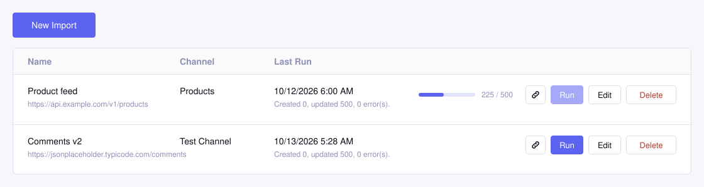
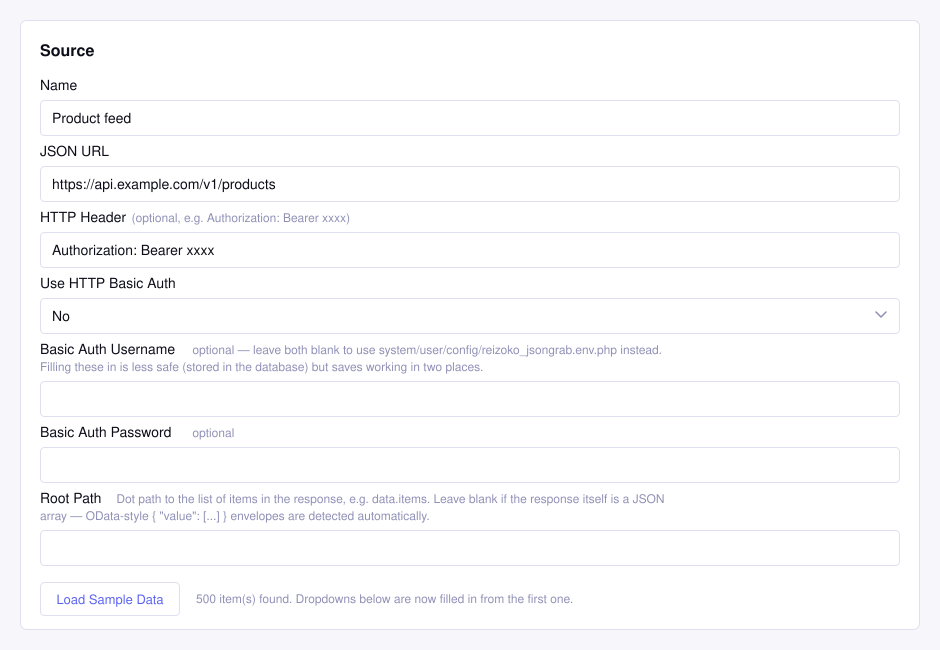
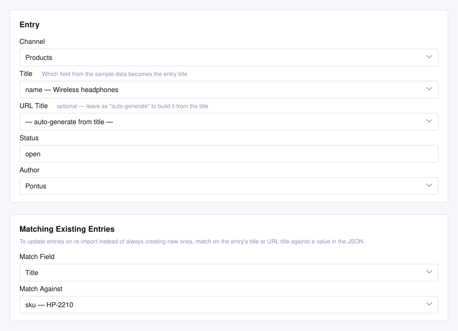
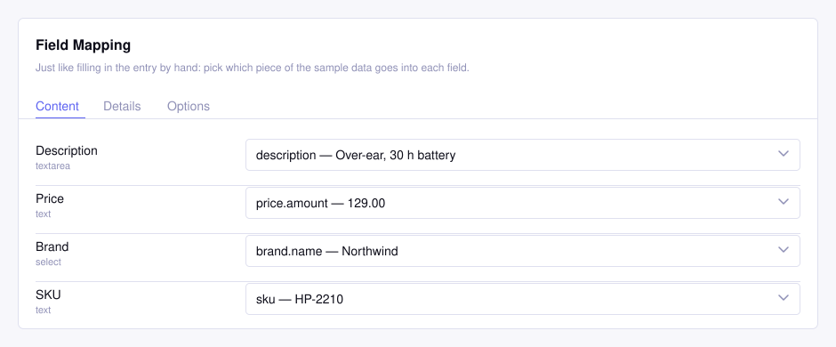
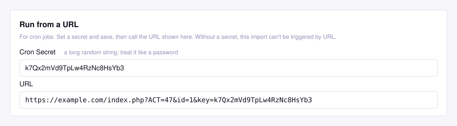

# JsonGrab

Import channel entries from any JSON API into ExpressionEngine 7, straight from the control panel.



Point JsonGrab at a URL, choose a channel, and map the JSON to your channel's fields using a live sample of the real response. Hit Run, and run it again whenever the source changes: existing entries are updated, new ones are created.

It is a small, focused add-on. No CSV, no XML, no WordPress import machinery. Just JSON in, entries out.

*Illustrations in this README show the control panel with sample data.*

## Why you might like it

- **Map from real data.** Load a sample from the endpoint and every dropdown is filled in from it. No typing JSON paths from memory.
- **Mirrors your Publish Layout.** The mapping screen uses the same tabs and field order as the channel itself.
- **Safe to re-run.** Match existing entries by Title or URL Title and a second import updates instead of duplicating.
- **Handles big feeds.** The control panel imports in chunks of 25 entries with a live progress bar, so 500 items do not run into PHP's time limit.
- **Fits into automation.** Run it from the CLI or give each import its own secret URL for cron jobs and webhooks.
- **Keeps secrets out of the database.** Basic Auth credentials can live in a config file instead of the CP.

## How it works

### 1. Tell it where the data lives

Give the import a name and a JSON URL. Add a custom HTTP header or HTTP Basic Auth if the API needs one, then press **Load Sample Data**.

If the response is a plain array, or an OData-style `{ "value": [...] }` envelope, JsonGrab finds the list on its own. Otherwise set a Root Path such as `data.items`.



### 2. Choose the channel and how entries are matched

Pick the channel, the sample field that becomes the title, the status and the author. To update entries on re-import, choose whether to match on Title or URL Title and which JSON value to match against. Leave it on "Always create new entries" to import everything as new.



### 3. Map the fields

Every field in the channel is listed under its Publish Layout tab with a dropdown of values from the sample.



Grid, Matrix, relationship and file fields are left out on purpose: a single JSON value cannot fill those in.

### 4. Run it

Press **Run** in the import list. Large feeds are saved in chunks with a progress bar, and the last-run summary updates when it is done.

## Installation

1. Copy `system/user/addons/reizoko_jsongrab` into your site's `system/user/addons/`.
2. Install it in the control panel under **Add-Ons**, or with `php eecli.php addons:install reizoko_jsongrab`.
3. Open **Add-Ons → JsonGrab** and choose **New Import**.

When updating from an earlier version, copy the files over and run the add-on update in the control panel.

## Running imports

### From the control panel

The **Run** button on the import list. This is the one with the progress bar.

### From the command line

```
php eecli.php reizoko_jsongrab:run --id=<import id>
```

Imports everything in one go and has no web server timeout, which makes it the best choice for very large feeds.

### From a URL

Open an import, fill in **Cron Secret** under "Run from a URL" and save. The URL is then shown right there, and the link icon in the import list copies it to the clipboard.



```
https://example.com/index.php?ACT=<action id>&id=<import id>&key=<secret>
```

- An import without a secret cannot be triggered this way.
- A wrong key, an unknown id and a missing secret all return the same `403 Forbidden`.
- The run happens in a single request, so use the CLI for very large feeds.
- The secret is part of the query string and can end up in access logs. Use a long random value and treat it like a password.

## Credentials file

To keep Basic Auth credentials out of the database, create `system/user/config/reizoko_jsongrab.env.php`:

```php
<?php
return [
    'JSONGRAB_API_USER' => 'username',
    'JSONGRAB_API_PASS' => 'password',
];
```

Set **Use HTTP Basic Auth** to Yes on the import and leave its username and password empty, and JsonGrab reads them from this file. Do not commit it.

## Requirements

- ExpressionEngine 7
- PHP 8.1 or newer
- PHP cURL extension

## Good to know

- Paginated APIs are not followed. The endpoint must return all items in one response, and it is fetched in full for every chunk.
- Imports never delete or unpublish entries that disappear from the feed.
- New entries are created on site ID 1 (no MSM site selection).
- Only a single custom HTTP header line is supported.

## More from Reizoko

More about [JsonGrab](https://www.reizoko.jp/en/addons/jsongrab.html) on reizoko.jp, which is also home to the other [Reizoko add-ons](https://www.reizoko.jp/en/addons.html).

## License

MIT, see [LICENSE](LICENSE).
